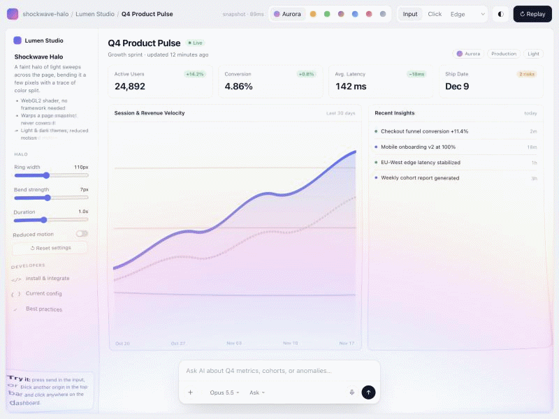

<div align="center">

# Shockwave Halo

**会弯折页面的 Web 光环动效** — 点击或聚焦输入框时，一道光环从起点扫过页面并淡出，像玻璃透镜般轻轻弯折内容、带一丝色散并点亮边框。**无依赖、不挑框架、静止时零开销。**

**简体中文** · [English](README.md)

[在线 Demo](https://amasun.github.io/shockwave-halo/) · [AI 接入](#让-ai-帮你接入或从零开始) · [可调整的内容](#可调整的内容) · [最佳实践](#最佳实践)

<p>
  
  
  
  
  
  
  <a href="https://x.com/Claude202309"></a>
  <a href="https://www.xiaohongshu.com/user/profile/5c094b50f7e8b948da476607"></a>
</p>

</div>

---

<p align="center">
  
  <br />
  <sub>七套内置配色，亮暗主题交替：光环从 AI 输入框扫起，经过时让页面轻轻弯折。</sub>
</p>

> [!TIP]
> **在线体验**：打开 [Shockwave Halo Demo](https://amasun.github.io/shockwave-halo/)，点击底部输入框即可看到效果；顶部工具栏支持实时切换起点、七套配色、明暗主题与减弱动效。

## 包含什么

两个**零依赖**、**不挑框架**的原生 ES 模块（React、Vue、Svelte 或纯 HTML 都能直接用）：

| 文件 | 角色 | 说明 |
|---|---|---|
| [`shockwave-halo.js`](shockwave-halo.js) | 核心光环 | 负责光环动画、透镜弯折、色散与边框高光；拿不到页面截图时自动降级为纯色环叠加，不影响使用 |
| [`ai-pill.js`](ai-pill.js) | 可选输入框 | 胶囊式 AI 输入框，点开会弹性展开成卡片，边缘带一圈转动的金属高光 |
| [`demo/index.html`](demo/index.html) | 完整示例 | 展示起点切换、七套配色、明暗主题与减弱动效 |

---
## 让 AI 帮你接入或从零开始

不用自己研究代码或看懂参数。你可以直接抄下面任意一句发给 **Claude Code / Codex / Cursor**，或者展开下方完整提示词整段复制给 AI，它会一步步确认你的需求并完成改造。

**常见场景示例：**
- *“我的博客是暗色主题，帮我接入 shockwave-halo，用 `Frost` 配色，只在点击搜索框时从输入框位置触发。”*
- *“我有个营销页和后台系统，帮我评估哪些页面适合加 shockwave-halo，只在关键按钮点击时触发，后台列表保持安静。”*
- *“我在写一个 SwiftUI iOS App，请按「从零开始」里的配方用 Metal 帮我实现一套同样的光环效果。”*

### 接入提示词

> 适合：**你已经有网页项目**（React / Vue / Svelte / 原生 HTML / Electron / Tauri），想直接把现成组件接进去。

<details>
<summary><strong>点击展开并复制「接入提示词」</strong></summary>

```text
Add the shockwave halo from https://github.com/amasun/shockwave-halo to my web app: when the AI input is clicked or focused, a faint halo of light sweeps across the page's content area from the input and fades out, bending the page a few pixels as it passes. Use the library as it is; do not copy its shader into my code. Do not change what the page does or how it looks at rest.

First read the library's README (https://github.com/amasun/shockwave-halo#readme), then the commented option lists at the top of https://github.com/amasun/shockwave-halo/blob/main/shockwave-halo.js (`DEFAULTS`) and https://github.com/amasun/shockwave-halo/blob/main/ai-pill.js (the `o = {...}` block) for every option and its default. Then look at my app and tell me, in a short list:
- the AI input (or whatever should trigger the halo), and what opens or focuses it;
- the content area the halo should cover: a non-scrolling element that holds the page under the toolbars, its corner radius, and whether it has `overflow: hidden`;
- any toolbars, and which edges of that area sit under one;
- how dark mode is switched (`<html data-theme>`, a `.dark` class, or something else);
- my framework and bundler.

Then ask me, one at a time, offering the default each time:
1. Trigger: focusing or clicking the AI input (default), a keyboard shortcut, sending a message, the AI starting to answer, or something else; and re-trigger while running: restart (default) or ignore.
2. Origin: the AI input (default), the point that was clicked, the middle of the area, or an edge.
3. Palette: Aurora (default), Halo, Frost, Spark, or my brand colors (then derive four rings inside to outside, with a brighter dark version and a softer light version).
4. Layers: bend, color split, edge refraction and line glints are all on by default; ask whether to turn any off.
5. Input: keep my AI input as it is (default), or replace it with the library's `ai-pill.js`.

Wait for my go-ahead, then integrate it:
- Install: `npm i github:amasun/shockwave-halo#v1.0.0 html-to-image`, then `import { createShockwaveHalo } from 'shockwave-halo'` and pass `snapshot: (el, opts) => toCanvas(el, opts)` with `toCanvas` from `html-to-image`. Without a bundler, import from `https://cdn.jsdelivr.net/gh/amasun/shockwave-halo@v1.0.0/shockwave-halo.js` instead.
- Create the halo on the content area when it mounts and call `destroy()` when it unmounts (in React, a `useEffect` with a ref; in Vue, `onMounted` / `onBeforeUnmount`; in Svelte, an action).
- Call `halo.trigger()` from the trigger I chose. If the input animates when it opens, pass `delay: 40`.
- Put the AI input, and anything else that animates or must stay above the halo, in `exclude` (a CSS selector), and give it a `z-index` above the halo's (`zIndex` option, default 5).
- Set `bevelEdges` to the edges that are not under a toolbar.
- Set `theme` so it follows my dark mode: `'auto'` covers `<html data-theme>`, `.dark` and the system setting; otherwise pass a function.
- Mark SVG strokes that are lines (graph edges, dividers), but not icons, with `data-halo-line` so they glint.
- If my content area scrolls, put the halo on a non-scrolling parent frame instead, because a scrolled area falls back to overlay-only.
- Add nothing to the page at rest, and no global CSS beyond what the library injects.

Check, and tell me what you checked:
- In dark and light mode, text under the halo stays readable and unsplit, the halo never shows on a toolbar, and the area's corners stay clean.
- `halo.mode` reads `snapshot` (not `overlay`) after the first trigger. If it reads `overlay`, say why: cross-origin images or fonts, a scrolled area, or no WebGL2.
- The trigger and origin are the ones I chose, the page works exactly as before, and nothing runs at rest.
```

</details>

### 从零开始

> 适合：**不引用本站项目，纯靠 Prompt 让 AI 从零制作**。无论是做手机 App / 桌面客户端（iOS Metal、Android AGSL、Flutter、Rust 等），还是想在自己的代码和设计系统里手写整套效果，都可以直接复制下面这段完整提示词给 AI。

<details>
<summary><strong>点击展开并复制「从零开始」提示词</strong></summary>

```text
Add a shockwave halo to my product: when something triggers it (by default, clicking or focusing the AI input), a faint halo of light sweeps across the page from one place and fades out, bending the page a few pixels as it passes, with a slight color split, in my dark and light modes. Build it inside my code and design system; do not change what the page does or how it looks at rest. Every value below is a default to start from, not a requirement.

First look at my app (section 0). Then ask me these one at a time, offering the default each time, and wait for each answer:
1. Trigger: what starts the halo (clicking or focusing the AI input, a keyboard shortcut, sending a message, the AI starting to answer, something else), and what happens if it is triggered again while one is running (restart, or ignore).
2. Origin: where it spreads from (the AI input, a button, the bottom edge of the page, the point that was clicked, the middle of a panel), and over which area (the page's content area, one panel, the whole window). Toolbars always stay clear.
3. Layers: the color rings (section 3) are always on; ask yes or no for each of the others: the bend (section 4), the color split, the refraction at the edges, the glints on lines and borders. The bend, the split and the refraction need the page as an image (section 6), so say what each costs on my platform.
4. Colors: one of the four palettes in section 3, or my brand colors (then derive four rings, and a dark and a light version, from them), and which modes my app has.
5. The input: leave my AI input as it is (the default), or turn it into the pill that springs open with a metal edge (section 1).
Then propose how you will build it on my platform (section 6 is a starting point, not a prescription), with the cost and any fallback, and wait for my go-ahead.

0. Start from what exists
- Find the AI input, what opens or focuses it, the page container it sits in, its corner radius, any toolbars over it, and whether the app has a dark mode.
- List what the page draws with (DOM, a canvas, a native view tree, a GPU renderer) and the platform version range: this decides how the bend can be done (section 6).

1. The input (only if I chose the pill)
- At rest: a pill 300 x 44 px, radius 22, white (dark: rgb(30 30 33)), a 1px hairline, a sparkle icon, the placeholder "Ask AI about this project" in 14px and a shortcut hint on the right. It sits centered on the page's content, 48px above the page's bottom.
- On click: the pill dips to 97% for 90ms, then springs open into a card 460 x 100, radius 16, growing from its center and keeping its bottom edge where it was. Spring: progress = 1 - exp(-8t) * cos(6t) over 580ms (barely past the end, settles by the end). The card's content is laid out at its final size from the start and is revealed as it grows; it fades in from 30% of the way. Height and radius follow the same progress.
- The open card: one line of text at 15px on a 22px line, 16px from the left, the caret first and the placeholder right after it; a hairline; then a toolbar 52px tall: a round add button, a short divider, two pickers (model, mode), and on the right a voice button and the send button, all 32px.
- Shadow: wide, soft and far, not heavy: 0 0 0 1px rgb(15 23 42 / 0.09), 0 2px 4px rgb(15 23 42 / 0.04), 0 28px 64px -16px rgb(15 23 42 / 0.22). No focus ring; focus shows only as the caret.
- The metal edge: a 1px border painted with a light silver gradient, linear-gradient(120deg, rgb(238 240 243), rgb(196 202 210) 28%, rgb(241 243 245) 50%, rgb(188 195 204) 74%, rgb(233 236 239)) (dark: rgb(74 79 87) to rgb(51 55 61)), with a highlight on top: conic-gradient(from <angle>, transparent 0 280deg, rgb(255 255 255 / 0.8) 325deg, transparent 360deg). Turn the angle from -60deg to 300deg over 900ms (ease-out) as the card opens, and fade the whole edge in and out over that time (opacity sin(pi * t), at most 0.75). Mask the gradient to the border only (mask with content-box exclude).
- Closing: back to the pill in 320ms, ease-in-out.

2. The halo's shape and timing
- The halo is a circle that grows from the origin I chose. The defaults assume the origin is the AI input at the bottom of the page: the circle's center sits below the page, horizontally at the input's center and 650px below the page's bottom edge, so what shows is a wide arc rising from the bottom.
- It starts with its middle at the page's bottom (radius 650) and grows by 800px over 1000ms, so it ends just past the page's top: radius = 650 + 800 * (1 - 2^(-9t)) / (1 - 2^(-9)). That is very fast at first and slow near the far edge.
- For another origin, keep the same timing and set the start and the growth so the halo starts at the origin and ends just past the farthest edge of the area: from a point inside the area, center the circle on the point and start at a radius of 0 to 40px; from an edge, put the center beyond that edge, about two thirds of the area's width away.
- Strength over the same time: min(1, t / 0.03) * (1 - t^2.2), so it is gone by the end and fades over its slow last stretch.
- It starts on the trigger (40ms after the input starts opening, if it opens).
- It stays in the area I chose: clip it to that area, with a straight edge under any toolbar and the area's own corner radius elsewhere (12px in the demo). It must never draw over a browser or app toolbar.

3. The rings and the palettes
- Across the halo's width sit four broad rings, one color each, inside to outside. With w = 110px and x = (distance from the center - radius) / w, ring i is centered at x = i - 1.5 with weight exp(-((x - c) / 0.8)^2); the color is the weighted average of the four, so neighbors blend softly. One fade covers all four: alpha = strength * exp(-1.1 * (x / 2)^2).
- Light mode tints the page: color = mix(page, ring, alpha * 0.24) + ring * alpha * 0.24 * 0.2.
- Dark mode adds light (screen): color = 1 - (1 - page) * (1 - ring * alpha * 0.3 * 1.5).
- Palettes, rings inside to outside. Each is tuned twice: brighter and more saturated on dark, softer on light.
  Aurora (blue through violet and pink to peach)
    dark: rgb(80 140 255), rgb(160 110 255), rgb(255 110 180), rgb(255 190 140)
    light: rgb(110 150 255), rgb(180 130 255), rgb(255 130 190), rgb(255 180 120)
  Halo (orange through amber to gold, like low sun through a lens)
    dark: rgb(255 150 60), rgb(255 190 70), rgb(255 225 120), rgb(255 245 210)
    light: rgb(255 140 50), rgb(255 175 60), rgb(245 200 80), rgb(255 225 150)
  Frost (mint and aqua with a touch of lime)
    dark: rgb(80 220 175), rgb(70 195 225), rgb(180 240 150), rgb(235 255 245)
    light: rgb(40 190 150), rgb(50 170 210), rgb(140 210 90), rgb(180 235 215)
  Spark (violet into gold)
    dark: rgb(140 100 255), rgb(200 130 255), rgb(255 200 110), rgb(255 235 170)
    light: rgb(130 95 240), rgb(185 125 245), rgb(245 185 80), rgb(250 215 120)

4. The bend
- The whole halo bends the page as one lens, never ring by ring (ring by ring reads as water ripples). With z = x * 0.75: push = 7px * 2.33 * z * exp(-z^2), along the direction away from the circle's center; read the page at position - push. Outside the halo's middle the page stretches, inside it squeezes, over about the width of the rings and no wider.
- Color split: at most a trace. Read red at 1.08 times the offset and blue at 0.92 times; text must stay clean.
- The frame holds the page: fade the lens to nothing over the last 56px before the page's edge, so the edge stays straight.
- The page's lines catch the light: where the halo passes, its rules, borders and the outlines of chips, cards and nodes brighten toward the ring color (mixed 20% toward white), at the halo's strength times exp(-1.4 * (x / 2)^2) times 0.3 on light and 0.14 on dark (a faint glint, not a redrawn border), read at their bent position so the glint follows them. Text and icons never light up. To find the lines, use a second capture of the page with every rule and border drawn white at its own width on black, and nothing else (no text, icons, pictures, fills or shadows); light the page where that capture is white, so a 1px border glints as 1px. Without a capture (a retrofit in the DOM), give each bordered element and divider a CSS variable from 0 to 1 by its distance to the halo's front each frame, and mix its border color toward the ring color by it.
- The edge as a glass bevel: at the sides and the bottom (not under a toolbar), where the halo reaches the edge, read the last 60px of the page from up to 22px further in (22 * (1 - d/60)^2 * the halo's strength there), so content beside the edge stretches toward it. Where the halo meets the edge, add a thin line of light (exp(-d / 7)) in the ring color mixed 45% toward white.

5. Rhythm
- On the trigger: if the input opens, it dips to 97% for 90ms, springs open (580ms) and its edge highlight turns (900ms); the halo leaves 40ms after the opening starts and runs 1000ms. Without the input, the halo runs on the trigger.
- Switching between dark and light cross-fades the halo's colors with the page; never cut.
- Reduced motion: no bend, no split and no glints; the halo fades in and out in place at half strength over 600ms.
- Draw only while the halo runs; nothing at rest.

6. How to build it, by platform
These are suggestions from what worked in the demo and what each platform offers; check them against my stack and its versions, and choose what fits. The halo itself (the rings, and the glints on lines and edges) is only an overlay and works anywhere. The bend needs the page as an image to sample from.
- Web, as in the demo: a WebGL2 canvas over the page draws everything in one fragment pass from a snapshot of the page. Cap the pixel ratio at 2; the canvas ignores pointer events and is removed or hidden at rest.
- Web, getting the snapshot:
  - HTML-in-Canvas (WICG): a canvas with the page as its child, drawn with drawElementImage() or uploaded as a WebGL texture, live and with real browser rendering. Behind the canvas-draw-element flag in recent Chromium and reported on by default from Chrome 157; no Firefox or Safari yet. Use it where present.
  - SVG foreignObject libraries (html-to-image, modern-screenshot): the browser renders the clone, so it is faithful, but images and fonts must be inlined or same-origin, the root needs a background color, and backdrop-filter is unreliable. Take it once on click (tens to a few hundred ms), then animate.
  - html2canvas (or html2canvas-pro): it re-implements CSS on a canvas, so modern effects (backdrop-filter, some gradients, oklch) may come out wrong. A last resort.
  - Fallback without a snapshot: draw only the halo in a transparent canvas over the page (light mode: normal alpha; dark mode: mix-blend-mode: screen or plus-lighter), and skip the bend. In Chromium only, a bend is possible with backdrop-filter pointing at an SVG filter with feDisplacementMap, at a cost.
- iOS (SwiftUI, iOS 17+): put the halo in a Metal [[stitchable]] function and apply .layerEffect(shader, maxSampleOffset: CGSize(width: 30, height: 30)) to the page view: it can sample the view at bent positions and add the color, live. Drive radius and strength from a TimelineView or an animatable value. Below iOS 17: an overlay with an AngularGradient and blur, without the bend.
- Android (API 33+): write the shader in AGSL as a RuntimeShader with a uniform shader named for the content, and set view.setRenderEffect(RenderEffect.createRuntimeShaderEffect(shader, "content")) on the page's root (in Compose: Modifier.graphicsLayer { renderEffect = ...asComposeRenderEffect() }). Update its uniforms every frame. Below 33: an overlay only.
- Flutter (Impeller): a FragmentProgram with ImageFilter.shader inside a BackdropFilter clipped to the page; the engine passes the content as sampler 0 and its size as the first vec2. Use FlutterFragCoord(), flip y on GLES, and check ImageFilter.isShaderFilterSupported, with an overlay-only fallback.
- Rust: render the UI into an offscreen texture, then draw one fullscreen pass with the same shader ported to WGSL that samples it.
  - wgpu by hand: render target texture with TEXTURE_BINDING usage, a fullscreen triangle, uniforms in one buffer.
  - Bevy: a custom post-processing node; call post_process_write() on the ViewTarget to get the source and destination textures, as in Bevy's custom post-processing example.
  - egui or iced on wgpu: render the frame into a texture through the renderer's wgpu callback and composite with the shader; their widgets cannot sample what is under them by themselves.
- Electron and Tauri: the web route; Electron can also take a snapshot with webContents.capturePage().

7. Check
- Dark and light, in the colors I chose: the text under the halo stays readable and unsplit; the halo never shows on a toolbar; the area's corners stay clean; the bend is no wider than the rings.
- The trigger and the origin are the ones I chose, and the page works exactly as before.
- It runs only while the halo is visible and costs nothing at rest.
```

</details>

---

## 可调整的内容

不用记参数名：用大白话告诉你的 AI 想要什么，它会帮你对应到具体设置。可以调整的内容如下。

| 调什么 | 你可以这样说 |
|---|---|
| **从哪里发出** | “从 AI 输入框发出”“从用户点击的位置发出”“从底边升起”“从中心扩散” |
| **配色** | “用 Frost 配色”“换成我们的品牌蓝”：七套内置配色（Aurora、Halo、Frost、Spark、Ocean、Rose、Silver），或自定义一组四色 |
| **亮 / 暗主题** | 自动跟随站点的暗色模式，切换时平滑过渡 |
| **效果图层** | “不要色散”“去掉玻璃边缘”“只留光环，不要弯折页面”：页面弯折、色散、玻璃边缘、线条高光都可以单独关闭 |
| **强度与速度** | “弱一点”“光环再宽一点”“稍微快一点”：光环宽度、弯折强度、时长 |
| **作用范围** | “别盖到工具栏”“输入框要在光环之上”：选择作用区域、排除元素、指定哪些边缘作为玻璃边 |
| **何时触发** | “聚焦时”“点击时”“AI 开始回答时”“运行中忽略新的触发” |
| **减弱动效** | 自动跟随系统设置：不弯折，只在原地柔和淡入淡出 |
| **AI 输入框（可选）** | 占位文字、快捷键、模型与模式标签、距底部的距离、颜色 |

---

## 最佳实践

> **把光环当作页面里的“标点符号”，而不是日常装饰。** 它带有空间弯折与色散，视觉存在感较强，只适合用来标记**值得用户注意的瞬间**，其余时间让界面保持安静。

| ✅ 适合使用 | ❌ 建议避免 |
|---|---|
| **唤醒 AI / 搜索框**：点击或通过 `⌘K` 聚焦输入框时 | **高频微交互**：鼠标 hover、普通下拉菜单、Tooltip |
| **状态确认与里程碑**：提交表单、发布成功、AI 开始/完成回答 | **列表常规操作**：勾选待办、翻页、筛选排序、增删行 |
| **聚焦模式切换**：进入演示、结账、全屏预览等重要转场 | **替代 Loading**：光环只运行 1 秒，不适合充当持续加载指示器 |

---

## 安装

三种方式任选其一，也可以直接把下方指令发给你的 AI 编码助手。

### 1. npm（从 GitHub 安装）

```bash
npm i github:amasun/shockwave-halo#v1.0.0 html-to-image
```

```js
import { createShockwaveHalo } from 'shockwave-halo';
import { createAIPill } from 'shockwave-halo/ai-pill';   // 可选
import { toCanvas } from 'html-to-image';

const halo = createShockwaveHalo(area, {
  snapshot: (el, opts) => toCanvas(el, opts),
});
```

### 2. CDN（无需构建工具）

```html
<script type="module">
  import { createShockwaveHalo } from 'https://cdn.jsdelivr.net/gh/amasun/shockwave-halo@v1.0.0/shockwave-halo.js';
  import { createAIPill } from 'https://cdn.jsdelivr.net/gh/amasun/shockwave-halo@v1.0.0/ai-pill.js'; // 可选
</script>
```

### 3. 直接复制文件

把 [`shockwave-halo.js`](shockwave-halo.js)（以及可选的 [`ai-pill.js`](ai-pill.js)）直接放进你的项目目录即可，无任何外部依赖。

> [!NOTE]
> **一句话让 AI 帮你装好**：如果你正在用 Cursor / Claude Code / Codex，可以直接对它说：  
> *“参考 https://github.com/amasun/shockwave-halo 帮我接入 shockwave-halo：挂载在主内容容器上，点击或聚焦 AI 输入框时触发 `Aurora` 光环，保持工具栏不被遮挡。”*  
> 需要更精细的引导？请看下文 [让 AI 帮你接入或从零开始](#让-ai-帮你接入或从零开始)。

---
## 快速上手

### 最小用法（3 步跑起来）

```js
import { createShockwaveHalo } from './shockwave-halo.js';

const area = document.querySelector('#content');   // 光环扫过的区域（把工具栏放在这个区域外面）
const input = document.querySelector('#ai-input');

const halo = createShockwaveHalo(area, { origin: input });
input.addEventListener('focus', () => halo.trigger());
```

> [!NOTE]
> 要让光环弯折页面，需要 `html-to-image` 拍摄页面快照：可以在页面中通过 `<script>` 提前引入（全局变量 `htmlToImage`），也可以什么都不做——组件会在需要时自动从 jsDelivr 加载 `html-to-image@1.11.11`。使用 Vite / Webpack 等打包工具时，建议如上方 npm 示例通过 `snapshot` 选项显式传入。

### 搭配胶囊输入框

```js
import { createShockwaveHalo } from './shockwave-halo.js';
import { createAIPill } from './ai-pill.js';

const halo = createShockwaveHalo(area, { exclude: '.aip' });   // 输入框自己会动，拍快照时排除它
const pill = createAIPill(area, {
  onTrigger: ({ delay }) => halo.trigger({ origin: pill.el, delay }),
  onSubmit: text => sendToAI(text),
});
```
